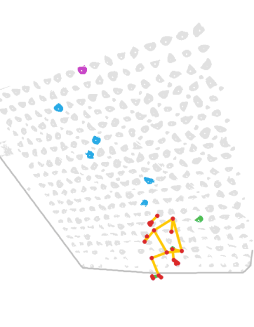
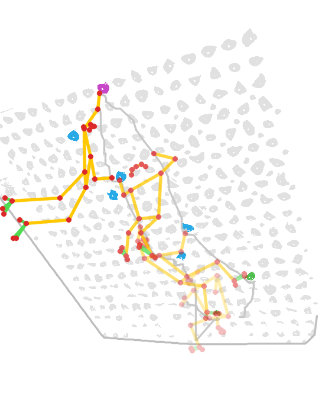
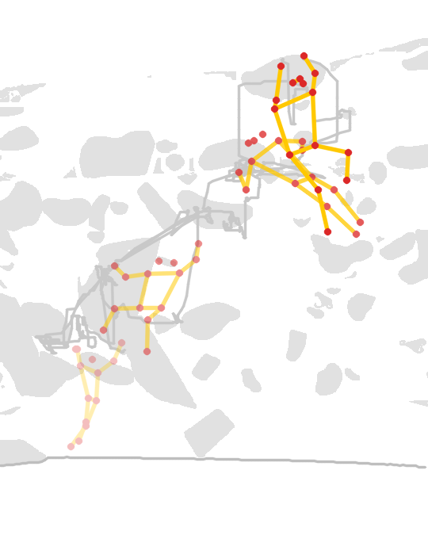

# Gym pattern of life on the edge

**Problem.** Climbing gyms and LED-board makers don't know how their walls are used: which problems are tried, sent
or abandoned, how long climbs take, how busy each wall is by hour. Staff watching and climbers logging their own sends
are the only sources today. Cameras could answer this, but nobody wants video of people in gym clothes stored
anywhere.

**What this does.** A Raspberry Pi 5 with a DeepX DX-M1 NPU watches a wall. Pose runs on the NPU; this code turns
the pose into climbs and counts. Only those leave the unit: for each climb, its start and end, problem, holds used and
skipped, high point, whether it was topped and how it ended. Per minute, how many people are on the wall and in front
of it. No frame is stored or sent.

## What it looks like

<p>



</p>

Drawn only from what the unit keeps: hold shapes from the map and the climber's body points from the NPU, never a
video frame. Left and middle: an LED-board problem, lit holds in colour (green start, blue hand, magenta finish), the
climber from sit start to the finish hold. Right: a commercial wall, purple route, to the top jug. Earlier moments are
fainter; grey lines are the hand paths. Made with `skeleton_figure.py`.

## How it fits together

```
camera ──> pose on the NPU ──> climb logic + wall map ──> climbs.jsonl, summary.json
           deepx_wholebody.py   gym_pol.py                 (gym_live.py runs it live)
           (or gym_live.py)     map: board_map.py / gym_map.py
```

## Files

| File | Runs on | What it does |
|---|---|---|
| [board_map.py](board_map.py) | Pi CPU, ~16 s | Map of an LED board: holds, outline, the lit problem (start / hand / finish / foot) |
| [gym_map.py](gym_map.py) | GPU, ~5 min | Map of a commercial wall: empty wall, floor mat, holds (SAM 2.1), routes as hold-colour groups |
| [gym_pol.py](gym_pol.py) | anywhere, 1 ms a frame | Climbs, routes, tops and per-minute counts from per-frame pose and a map |
| [gym_live.py](gym_live.py) | Pi + NPU | Live runner: DeepX pose on a video or stream, appends climbs as they end, summary every minute |
| [deepx_wholebody.py](deepx_wholebody.py) | Pi + NPU | Pose on a video: YOLO11s-pose finds the climber, RTMW (133 points) runs on a crop around them |
| [deepx_rtmw_prep.py](deepx_rtmw_prep.py) | laptop | Prepares RTMW for the DeepX compiler: normalisation folded in, batch 1, calibration crops |
| [deepx_wholebody_compare.py](deepx_wholebody_compare.py) | laptop | What the NPU's quantisation costs: DeepX RTMW against the same model unquantised |
| [skeleton_figure.py](skeleton_figure.py) | anywhere | A climb as stick figures on a plain canvas (PNG, and an animated GIF) from a map and pose |
| [tracker.py](tracker.py) | | The people tracker: one ID per person from frame to frame, with lost tracks re-linked |

## Running it

On the Pi, for a new LED-board camera view (no GPU needed at any step):

```
python3 deepx_wholebody.py VIDEO models/yolo11s-pose_deepx_model rtmw-dw-x-l_256x192.dxnn pose.npz
python3 board_map.py VIDEO board_map/ --pose pose.npz     # empty board = the longest stretch with nobody detected
python3 gym_pol.py board_map/ pose.npz out/               # climbs.jsonl, summary.json, pol_preview.jpg
python3 skeleton_figure.py board_map/ pose.npz climb.png --gif climb.gif --from 15.5 --to 31   # optional figures
```

Live, from a camera stream or a file: `python3 gym_live.py rtsp://... board_map/ out/ [--deploy]`. `--deploy` reports
per-minute counts below 3 people as 0, so no small group can be singled out.

A commercial wall needs `gym_map.py VIDEO map/` once on a GPU (SAM 2.1 and YOLO11m-pose weights in `MODELS_DIR`, or set by `SAM_WEIGHTS`
and `DET_WEIGHTS`); everything after it runs on the Pi.

Requirements: `numpy`, `opencv-python`; `ultralytics` for the YOLO models; `dx_engine` (DeepX runtime) on the Pi;
`scikit-learn` for `gym_map.py`; `onnx` and `rtmlib` for the two DeepX preparation scripts.

## How a climb is read

- **Tracking:** people are tracked from box to box. Duplicate NPU boxes are dropped, and a track lost on the wall is
  continued by a new one that appears nearby within 10 s.
- **On the wall:** feet above the floor line by 6% of the wall's height, held for 0.5 s; off below 3%. On an LED board
  a hand on a lit start hold also counts (a sit start keeps the feet at floor level), and a hand on any hold keeps the
  climber on.
- **On a hold:** a hand (wrist pushed out along the forearm) or foot still for 0.4 s, matched to the nearest hold.
- **Route:** on a board, the lit problem. On a commercial wall, the colour group with most holds touched, hand holds
  counting twice.
- **Topped:** on a board, a hand on the lit finish hold. On a commercial wall, both hands on the route's highest hold,
  or one for 1 s.
- **End:** dropped off (feet fall 0.3 wall heights within 0.7 s), climbed down, lost, or in progress.
- **Per climb also:** high point, holds touched, and on a board the lit holds used and skipped.
- **Aggregates:** per minute, people on the wall and in front of it, climbs and tops; per route, attempts, tops and
  median duration; a coarse grid of hand contacts.

## Results so far

Three phone videos, one climber each, checked by eye. Pose ran on the DeepX NPU on the Pi.

**Commercial wall** (colour-coded routes; map from `gym_map.py`: 75 holds, one volume, 7 colour groups):

| | By eye | Found |
|---|---|---|
| Climbs | 1 | 1 |
| Start / end | ~3–5 s / ~42.3 s | 5.1 s / 42.4 s |
| Ended by | dropping off | dropped off |
| Route | purple jugs | purple (vote 43%; the hand holds are the purple jugs) |
| Topped | yes, ~41 s | yes |
| Person behind the top of the wall | not climbing | not counted |

**LED board, two camera positions** (map from `board_map.py`):

| | Video 1: by eye | found | Video 2: by eye | found |
|---|---|---|---|---|
| Lit problem | 1 start, 4 hand, 1 finish | same | 2 start, 5 hand, 1 finish | same |
| Climb start | sit start, ~4–5 s | 4.3 s | sit start, ~15 s | 15.9 s |
| Topped | finish hold ~26–28 s | 26.4 s | finish hold ~30–31 s | 30.8 s |
| End | drops off ~29 s | 29.7 s, dropped off | drops off ~32 s | 31.8 s, dropped off |
| Lit holds used | | 6 of 6 | | 6 of 8; by eye he skips both |

Without the board start rule the starts were 8–9 s late.

**Speed on the Pi:** pose 10–16 fps with another camera sensor sharing the NPU; the climb logic 1 ms a frame.
`gym_live.py` runs end to end at 16 fps.

## Pose on the DeepX NPU

RTMW compiles with DX-COM 2.4.1 once ImageNet normalisation is folded into the graph (`deepx_rtmw_prep.py`). The
compiled model takes uint8 HWC crops; a float CHW input is accepted silently and gives wrong points.

Commercial-wall clip, all 1,305 frames. Error is the median distance to YOLO11x-pose at 1280 on a GPU, in % of trunk
length, for the 17 body points (NPU shared with another sensor):

| On DeepX | fps | Median error | Within 10% | Head / arms / legs |
|---|---|---|---|---|
| YOLO11s-pose, one pass | 14.2 | 15.1% | 34% | 5.9 / 13.3 / 20.0% |
| YOLO11s-pose, second pass on a crop | 7.9 | 12.8% | 40% | 4.9 / 12.7 / 15.7% |
| YOLO11s-pose + RTMW dw-l-m | 11.2 | 8.1% | 59% | 4.5 / 7.0 / 12.1% |
| **YOLO11s-pose + RTMW dw-x-l** | **11.0** | **8.1%** | **59%** | **3.9 / 7.2 / 11.6%** |

- **Quantisation:** against the same RTMW unquantised on the same boxes, the NPU differs by a median 1.0–1.4% of
  trunk across body, feet, face and hands, and agrees on which points are visible 97–100% of the time. Model size and
  resolution, not the chip, set the accuracy.
- **With the NPU to itself:** YOLO11s-pose alone 21.4 fps; with RTMW dw-x-l 15.5 fps (detect 42 ms, RTMW 16 ms).
  Detection is the bottleneck.

## Not yet shown

- several climbers at once, and a full day of use;
- commercial walls where one hold colour is used for several routes (the learned replacement: group holds that the
  same climbs use together);
- falls as opposed to deliberate drop-offs (both are "dropped off");
- finding which problem a board is showing in the board maker's problem list (needs that list's terms checked).
